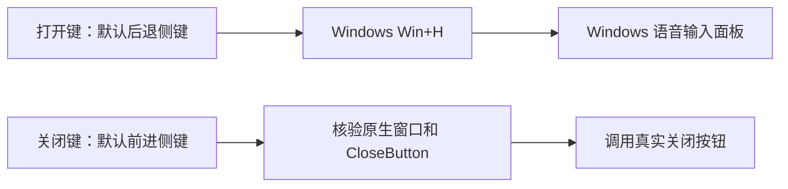
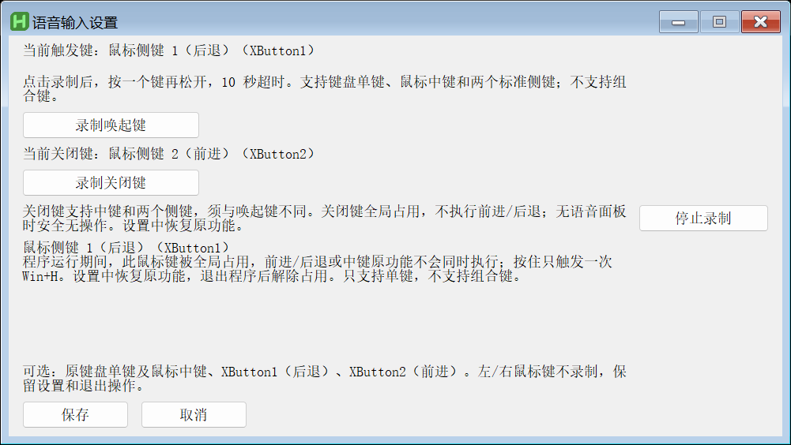

# Win Voice Hotkey

**把 Windows 语音输入，放到顺手的一颗按键上。**

默认按鼠标后退侧键打开 Win+H，按前进侧键直接关闭语音面板。正在录音时也可以关闭，无需先点麦克风。中文托盘与设置界面，支持分别录制打开键和关闭键。

版本：`0.1.1`。工具代码采用 MIT；随包运行时保留其原有 GPL v2 许可。

## 安装与开始使用

从 [Releases](https://github.com/SuTaiHui1/win-voice-hotkey/releases) 获取 Windows x64 发行包。GitHub 的 **Code → Download ZIP** 是开发源码；普通用户请下载 Release 附件。

| 文件 | 用途 |
| --- | --- |
| `win-voice-hotkey-0.1.1-windows-x64-setup.exe` | 按用户安装，添加开始菜单入口，不需要管理员权限 |
| `win-voice-hotkey-0.1.1-windows-x64-portable.zip` | 解压到可写目录，双击 `WinVoiceHotkey.exe` 使用 |
| `win-voice-hotkey-0.1.1-source.zip` | 工具源码、构建与测试脚本 |
| `SHA256SUMS.txt` | 以上文件的 SHA-256 校验值 |

安装包和便携包已包含固定版本的 AutoHotkey；使用时不用安装 Python、AutoHotkey、Visual Studio 或其他开发环境。需要 Windows 自带的 .NET Framework 4.x。

1. 先在记事本的空白编辑区按一次 **Win+H**，确认 Windows 自带语音输入可以正常使用。
2. 安装版：运行安装包，确认目标目录，从开始菜单启动 **Win Voice Hotkey**。便携版：完整解压，双击 `WinVoiceHotkey.exe`，不要在 ZIP 内直接运行。
3. 点击要输入的文本框，按鼠标**后退侧键（XButton1）**打开语音输入。
4. 按鼠标**前进侧键（XButton2）**关闭面板，包括正在录音的状态。
5. 右键通知区域的图标 → **设置**，可以更换按键。双击托盘图标也可打开设置。

没有侧键的鼠标可以在设置中给打开动作选择键盘单键，给关闭动作选择中键。

**发行的启动程序、关闭辅助程序和安装程序未使用商业代码签名证书。** Windows 或安全软件可能显示未知发布者、信誉不足或拦截提示。请核对项目地址与校验和；如果设备策略不允许运行，请停止并联系设备管理员，或审查源码后自行构建。不要关闭系统安全保护。

使用 PowerShell 校验文件：

```powershell
Get-FileHash .\win-voice-hotkey-0.1.1-windows-x64-setup.exe -Algorithm SHA256
```

## 按键行为

| 动作 | 默认 | 可选范围 |
| --- | --- | --- |
| 打开语音输入 | XButton1（后退侧键） | A–Z、0–9、常见标点/符号键、数字小键盘字符/运算符键、左/右 Shift、CapsLock、Tab；中键、XButton1、XButton2 |
| 关闭语音面板 | XButton2（前进侧键） | 鼠标中键、XButton1、XButton2 |

不支持自定义组合键、左/右鼠标键、滚轮方向、Alt/Win/Ctrl 单键、电源键、Pause/Break、功能键和导航键作为普通设置选项。数字小键盘受键盘布局与 NumLock 状态影响，以录制结果为准。某些键能被系统识别出名称，但仍会在设置中明确拒绝绑定。

- **打开键与关闭键不能相同。** 设置会拒绝冲突，不会悄悄替换用户的另一个绑定。
- 运行期间，普通打开键的原字符/原动作被占用；按住只触发一次。Shift 保留原有组合键行为，只在单独按下并松开时触发。
- 鼠标打开/关闭键在映射期间被占用，不会同时执行浏览器前进、后退或中键动作。
- 关闭键即使未发现面板也被占用，此时只是不执行关闭。退出工具可恢复按键原功能。
- 设置窗口打开时暂停映射，支持独立录制，10 秒超时。录制后先松开按键再保存；取消不会写入新绑定。
- 工具是**全局快捷键映射**：不会根据文本框类型、密码框、应用名单或聊天对象决定是否触发。是否允许语音输入由 Windows 与目标应用决定。
- 打开动作发送 Win+H。再次按打开键的效果由 Windows 当前状态决定，不是本工具提供的开关状态机；可靠关闭应使用独立关闭键。



上图为行为示意图。下面是默认按键的真实设置界面：



图片由 v0.1.1 的生产设置函数创建真实窗口后，在隔离测试实例内请求窗口自身绘制而成；没有读取桌面像素，也未启用输入钩子或麦克风。隔离桌面的主题、字体及 DPI 可能与日常桌面略有不同。[截图来源与隐私边界](docs/SCREENSHOTS.md)

## 系统要求与兼容边界

- Windows 11 x64，Windows 自带 Win+H、麦克风与相应语音语言可用。
- .NET Framework 4.x；构建使用系统中的 64 位 C# 编译器，不打包另一个 .NET 运行时。
- 普通用户权限运行。受保护桌面、锁屏、UAC、安全策略限制和以管理员权限运行的目标应用不在保证范围内。
- 关闭功能依赖 Windows 11 当前语音面板的原生窗口及 UI Automation 标识。Windows 更新可能改变结构。无法可靠核验时不发送关闭操作，状态菜单会说明结果。
- Windows 10、ARM64、其他 Windows 11 版本、远程桌面、第三方壳层、多用户会话与管理员应用均未完成兼容验证。
- 先前运行版本已由真实用户验证录音中关闭，记录到 7 次真实关闭成功并确认流畅；这是单台机器上的历史接受结果，不代表本发行包的跨设备保证。见 [验证范围](docs/TESTING.md)。

## 网络与隐私

本工具不提供自己的语音识别服务，不采集麦克风音频、不保存录音、不读取输入框文本，不上传按键记录或遥测，也不会自动提交、发送输入内容。运行时不自动联网更新。

Windows 语音输入使用 Microsoft 的在线语音识别服务，因此需要网络和可用麦克风。语音会按照 Windows 的隐私与语音设置由系统处理。本工具不能让系统的在线语音识别变为离线，也不能替用户作出麦克风/在线识别授权。[Microsoft 官方说明](https://support.microsoft.com/en-us/accessibility/windows/use-voice-typing-to-talk-instead-of-type-on-your-pc)

为找到正确的关闭按钮，工具会在内存中观察候选系统窗口的类名、进程与线程标识、创建时间、可见性和控件标识；不读取窗口标题或编辑文本。正式版不写触发历史，不保存窗口快照或截图。数据目录中的 `mapping-state.ini` 只用于本实例状态、按键设置与退出识别；辅助进程的随机就绪文件在退出时清理。

更多信息：[隐私说明](docs/PRIVACY.md)。

## 自启、配置、升级与卸载

**自启默认关闭。** 右键托盘 → **开机自启**，勾选时在当前用户的启动文件夹创建 `WinVoiceHotkey.lnk`，再次点击删除。不会修改系统级服务、任务计划或注册表权限。

| 模式 | 程序目录 | 用户数据 |
| --- | --- | --- |
| 安装版 | `%LOCALAPPDATA%\Programs\WinVoiceHotkey` | `%APPDATA%\WinVoiceHotkey` |
| 便携版 | 用户解压的位置 | 同目录下的 `data` |

配置只包含是否启用、打开键和关闭键。现有开发版/其他 CapsWriter 安装不会被自动读取或迁移。请先退出旧映射，再在新工具中重新选择按键，避免多个程序占用同一键；新安装不主动停止、覆盖旧工具。

升级：退出工具，先卸载旧程序（保留用户数据），再安装新版。安装器遇到非空目标目录会停止，避免覆盖未知文件。便携版可解压到新目录，再在退出后复制自己的 `data\config.ini`；不要复制诊断日志或临时状态文件。

安装版卸载：开始菜单 → **Win Voice Hotkey → Uninstall**。卸载会退出本工具并移除自启和程序文件，保留用户数据。运行中的 `Uninstall.exe` 会暂时留在安装目录；关闭卸载窗口后可手动删除该目录。也可从原安装包执行 `--uninstall`，此时所有程序文件可直接移除。若需清空配置，再自行删除 `%APPDATA%\WinVoiceHotkey`。

便携版卸载：先取消开机自启，再从托盘退出，然后删除解压目录。保留整个 `data` 可保留自己的设置。

## 常见问题

**按侧键没反应？**

确认程序在托盘运行、设置窗口已关闭、鼠标驱动输出标准 XButton1/XButton2。先在记事本按 Win+H 排查系统功能，再尝试本工具。不要同时运行其他侧键映射程序。

**能打开，但关不掉？**

右键托盘 → 查看状态。如果辅助程序尚未就绪，退出本工具再启动。语音面板若已在本工具启动前打开，手动关闭后重新打开，使窗口跟踪器看到新的显示事件。Windows 更新改变面板结构时，工具会停止关闭；可直接点击 Windows 面板上的关闭按钮并提交不含个人信息的问题报告。

**浏览器不再后退/前进？**

这是被选作映射键时的预期行为。退出工具即可恢复；也可以打开设置更换按键。

**能用其他鼠标按钮、组合键或 F 键吗？**

本版仅支持上表范围。鼠标厂商的额外按键需要驱动将其映射为标准按键；这种映射是否可被本工具识别未保证。禁止在配置中填写 AutoHotkey 表达式或任意脚本。

**托盘图标找不到？**

检查 Windows 通知区域的折叠菜单。也可运行 `WinVoiceHotkey.exe --settings`。停止可运行 `WinVoiceHotkey.exe --stop`，该命令仅向具有本工具实例标识的窗口发出退出请求。

**设置损坏，启动不了？**

先停止工具，将自己的数据目录中的 `config.ini` 重命名备份，再启动以生成默认设置。不要删除其他软件的数据目录。

**首次启动被安全软件阻止？**

此版本未签名。请核对下载来源、校验和与源码，按组织策略处理；不要关闭保护、添加全目录排除或绕过安全警告。校验和只证明文件一致，不等同于安全审计或发布者身份签名。

## 开发与构建

构建机器：Windows x64、Windows PowerShell 5.1+ 或 PowerShell 7、Windows 自带 .NET Framework 4.x 编译器，首次需要 HTTPS 访问固定的 AutoHotkey 官方依赖。无 NuGet、npm 或第三方安装器依赖。

```powershell
.\scripts\Build.ps1
.\scripts\Test.ps1
```

输出位于 `out`。请先保留旧产物，再删除自己确认过的生成目录后重新构建。不要为了运行构建脚本降低系统执行策略；受管理设备可使用获准的开发环境或 GitHub Actions。[构建细节](docs/BUILDING.md)

仓库提供 Windows CI 构建与不触发语音的逻辑回归；推送 `v0.1.1` 等标签后可生成 GitHub Release。CI 的 GUI/实际系统语音未作为跨系统验收。新仓库正式运行前不提供虚构的绿色构建徽章。

欢迎阅读 [贡献指南](CONTRIBUTING.md)、[安全报告](SECURITY.md)、[变更记录](CHANGELOG.md)。

## 来源与许可

这个工具由此前的本地 Win+H 快捷键原型整理而来。发布运行链不包含 CapsWriter 的 ASR 模型、Python 客户端/服务端、旧焦点适配器或旧 UIA-v2 库。保留下来的内部名称已改为本项目名称。

工具自行编写的代码与文档采用 [MIT](LICENSE)。AutoHotkey 2.0.30 保持原有 GPL v2 及内含第三方声明；便携包与安装包附带对应版本完整上游源码归档。MIT 许可不覆盖第三方运行时。[第三方声明](THIRD_PARTY_NOTICES.md)
